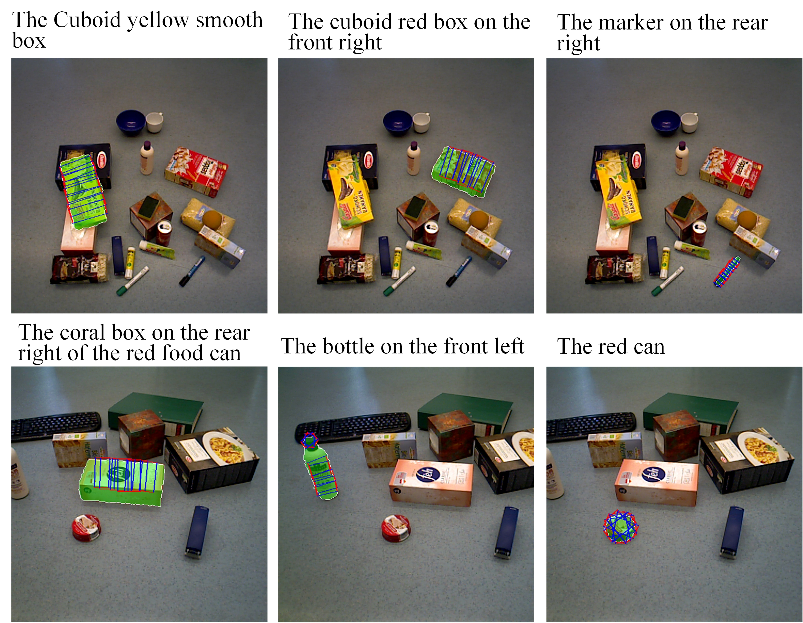

# KARNet Grasp
This is the official repository of the paper "Infusing Multi-Source Heterogeneous Knowledge for Language-Conditioned Segmentation and Grasping".


### Dataset:

Our RefOCIDGrasp annotation: [Google Drive](https://drive.google.com/drive/folders/1tKdB7tIugG3hKUOCYzxjNajqSqnk6Wo0?usp=drive_link)



```
-data (folder)
----ref-OCID-Grasp (our annotation)
--------train_expressions.json
--------test_expressions.json
--------val_expressions.json

----OCID_grasp (from https://github.com/stefan-ainetter/grasp_det_seg_cnn)
--------ARID10
--------ARID20

-dataset
----referRGBDDataset.py
```

#### Related datasets

OCID: [URL](https://www.acin.tuwien.ac.at/en/vision-for-robotics/software-tools/object-clutter-indoor-dataset/)

RefOCID: [Github](https://github.com/lluma/OCID-Ref)

OCIDGrasp: [Github](https://github.com/stefan-ainetter/grasp_det_seg_cnn)


### Train

```
python train_oneGPU.py --device 0 --model_name xxx --batch_size 32 --output_dir checkpoints/xxx --use_mask --weak_aug --strong_aug --use_kg --log_name=''
```

### test
```
python test_evaluation.py --model_name kggrasp --use_mask --use_kg --device 1 --split val --resume checkpoints/bn_preln_best/xxx.pth  --log_name xxx
```